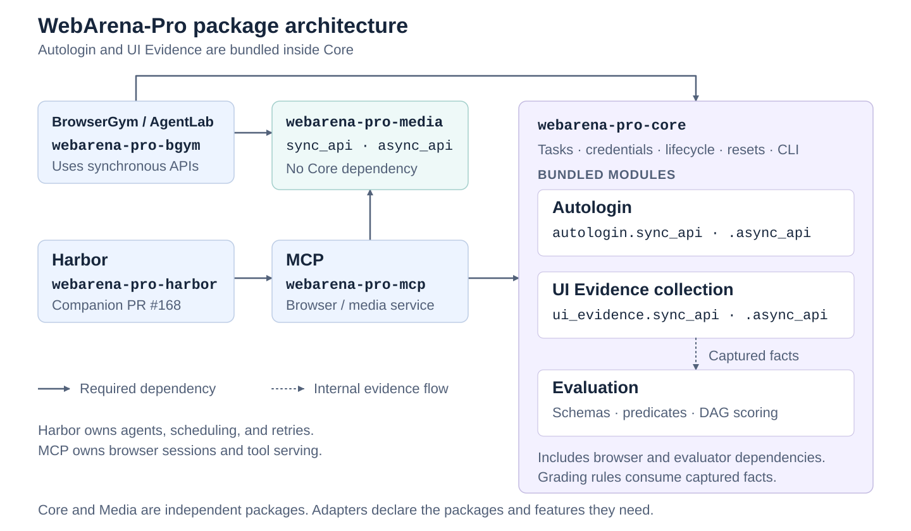
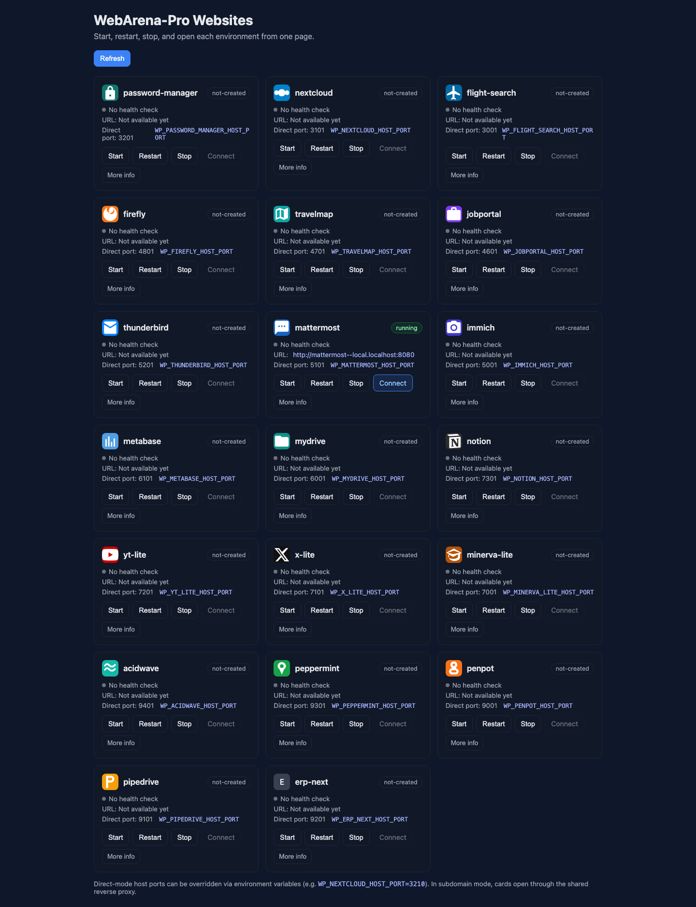

# Benchmark overview

WebArena-Pro combines realistic website replicas, browser-agent integrations,
and auditable evaluation in one monorepo. Agents can use browser actions,
screenshots, accessibility trees, audio transcription, and video-frame
extraction. Isolated workers keep concurrent tasks from sharing mutable site
state, and DAG traces record evaluation criteria, evidence, and scores.

## Task splits

The active corpus contains 400 distinct tasks in two disjoint partitions:

| Split | Tasks | Purpose | Preview from `webarena-pro-bgym/` |
|---|---:|---|---|
| `dev` | 100 | Agent development, debugging, and tuning | `uv run webarena-pro run --split dev --list` |
| `test` | 300 | Benchmark evaluation | `uv run webarena-pro run --split test --list` |

Within `webarena-pro-core/src/webarena_pro_core/config/`, website
`*.raw.json` files contain only Test tasks. Dev tasks and their evaluators
live only in `splits/dev.json`. Each task is stored once, with setup and intent
alongside an evaluation DAG under `eval`.

The BrowserGym CLI selects Test by default. Use `--split`, `--site`, and
`--task` together to filter the selection. `--list` previews task IDs without
starting agents or website containers. See the
[task configuration guide](https://github.com/McGill-NLP/webarena-pro/blob/main/webarena-pro-core/src/webarena_pro_core/config/README.md)
for the schema.

## Choose an integration

| Package | Responsibility | Guide |
|---|---|---|
| `webarena-pro-core` | Framework-neutral website lifecycle, task loading, resets, evaluators, and sync/async login and UI evidence | [Core](https://github.com/McGill-NLP/webarena-pro/blob/main/webarena-pro-core/README.md) |
| `webarena-pro-media` | Independent sync and async audio/video capture, processing, and transcription | [Media](media.md) |
| `webarena-pro-bgym` | BrowserGym environments, AgentLab studies, supervised workers, and dashboards | [BrowserGym/AgentLab](https://github.com/McGill-NLP/webarena-pro/blob/main/webarena-pro-bgym/README.md) |
| `webarena-pro-mcp` | Browser/media MCP service for external agents, with private Core evaluation | [Playwright MCP](mcp.md) |
| `webarena-pro-harbor` | Native Harbor task export, deployments, private result collection, and Core rewards | [Harbor](harbor.md) |

Core serves integrations without depending on an agent runner. BrowserGym
and MCP/Harbor support both Dev and Test.
Application implementations and seed assets live in `websites/`, and the
Sphinx documentation lives in `docs/source/`.

The native CUBE integration has been removed, including its benchmark
registration, recipes, and viewer. Use [BrowserGym/AgentLab](running-agents.md)
for agent runs and trace inspection, or connect external agents to the
[Playwright MCP service](mcp.md). See the [Harbor guide](harbor.md) for native Harbor trials.
Historical reports retain the integration names and results measured at the time.

## Package architecture

[Download the architecture diagram (SVG)](_static/package-architecture.svg).
Solid arrows point toward required packages. The dotted arrow shows captured
facts flowing between modules inside Core.

BrowserGym and MCP depend on Core and Media. Autologin and UI
evidence collectors are modules inside Core, each with `sync_api` and
`async_api` interfaces. BrowserGym uses the synchronous interfaces;
MCP uses the native async modules. A separate `core-async` package is not needed.

Core installs Playwright and evaluator libraries by default. Install a Chromium
binary for live login and UI collection. Task loading and evaluation of captured
facts do not initialize the browser. Media is installed directly by its users
and adapters. Core and Media have no package dependency on each other.
See the [media API guide](media.md#python-helpers).
Evaluators apply rules to captured
facts without calling browser APIs, even though collection and grading now
ship in the same distribution.

The diagram also includes the [Harbor integration](harbor.md).
Harbor depends on MCP, which supplies its Core and Media dependencies. Harbor
owns its agent loop and scheduling. MCP supplies the reusable session service;
agent implementations live outside the MCP package.

## Website catalog

The runtime registers 20 environments. CLI IDs are shown in backticks.

| Site | Environment | Site | Environment |
|---|---|---|---|
| `acidwave` | Music streaming | `erp-next` | Business operations |
| `firefly` | Personal finance | `flight-search` | Flight search and booking |
| `immich` | Photo management | `jobportal` | Recruiting and job search |
| `mattermost` | Team messaging | `metabase` | Business intelligence |
| `minerva-lite` | Student registration | `mydrive` | Cloud file storage |
| `nextcloud` | Collaboration and storage | `notion` | Documents and workspaces |
| `password-manager` | Password vault | `penpot` | Design collaboration |
| `peppermint` | Help desk | PipeCRM (`pipedrive`) | CRM and sales pipeline |
| `thunderbird` | Email | `travelmap` | Lodging and travel |
| `x-lite` | Social network | `yt-lite` | Video platform |

Use `uv run webarena-pro env dashboard` to inspect containers and connect to
sites through the local environment dashboard. See [environment commands](cli.md#environment-commands)
for startup, login, and lifecycle controls.

## Evaluation

Every Dev and Test task uses a dependency-aware evaluation DAG. Its rubric
nodes try their configured strategies in list order, conventionally arranged
by tier:

| Tier | Evidence | Typical checks |
|---|---|---|
| 0 | Application state, downloads, or final answers | Backend assertions, file validation, answer matching |
| 1 | Recorded browser actions or live page state | Browser events and DOM checks |
| 2 | LLM judgment over the task context | Fallback when earlier strategies cannot decide |

Nodes use the tiers relevant to their rubric. The numeric tier labels evidence;
the strategy type supplies the default trust policy. Inconclusive checks fall
through under `both` and `pass_only`; `terminal` stops on any returned verdict.
`backend_state`, `answer_match`, and `file_downloaded` default to `both`, so
definitive passes and failures are final. `browser_event` and `ui_state` default
to `pass_only`, allowing misses to fall through. The DAG supplies the
task score, including any LLM fallback; there is no additional whole-task
rubric judge.

See [DAG evaluators](evaluators.md) for scoring and authentication,
[step budgets and reporting](running-agents.md#step-budget-and-reporting)
for comparable results, and [media actions](media.md) for multimodal support.
