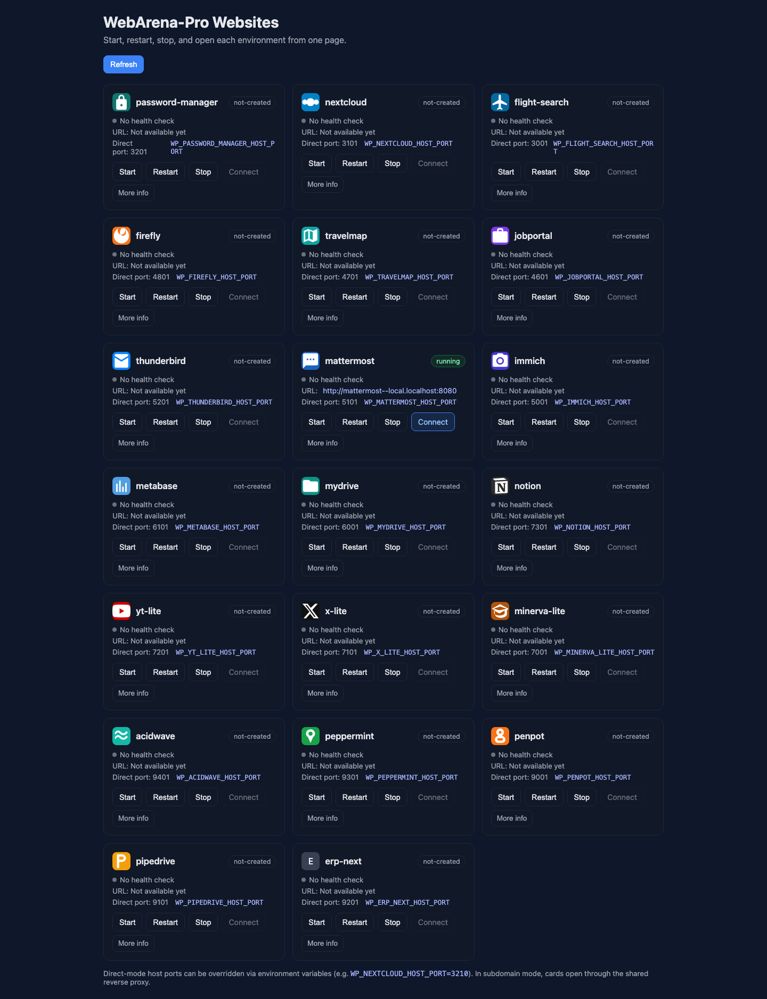

# CLI

The `webarena-pro` CLI lives in `webarena_pro_core.cli`. It manages website
containers, serves the local environment dashboard, and delegates benchmark
runs to `webarena-pro-bgym` when that package is installed.

The examples use `uv run` from an installed package directory: use
`webarena-pro-core/` for environment commands or `webarena-pro-bgym/` for both
environment and agent-run commands. See [Getting Started](getting-started.md)
and [Running Agents](running-agents.md) for installation.

CLI output uses color automatically when stdout is a terminal. Set `NO_COLOR=1`
or `WEBARENA_PRO_NO_COLOR=1` to disable styling, or `FORCE_COLOR=1` /
`WEBARENA_PRO_FORCE_COLOR=1` to force ANSI color in redirected output.

## Help

```bash
uv run webarena-pro -h
uv run webarena-pro help
uv run webarena-pro env -h
uv run webarena-pro env start -h
uv run webarena-pro env dashboard -h
uv run webarena-pro run -h
uv run webarena-pro run dashboard -h
```

Use `-h` or `--help` at the command level you want to inspect. The only
`help` subcommand kept for convenience is the top-level `webarena-pro help`
alias.

## Environment Commands

List available environments:

```bash
uv run webarena-pro env list
```

Pull images:

```bash
uv run webarena-pro env pull nextcloud
uv run webarena-pro env pull all
```

`env pull` always contacts the registry, even when an image is already cached
locally. It reports `Pulled` for a newly downloaded image, `Updated` when the
local image ID changes, or `Already current` when it stays the same. A failed
pull is reported as a failure and returns a nonzero exit code; `pull all`
continues checking the remaining images before returning. Pulls honor
`WP_DOCKER_PLATFORM` (or `DOCKER_DEFAULT_PLATFORM`) and the configured ARM
fallback. `env start` still reuses cached images without refreshing
them. After pulling an update, run `env start <name>` to recreate an existing
container if its image changed.

Start environments:

```bash
uv run webarena-pro env start nextcloud
uv run webarena-pro env start x-lite minerva-lite
uv run webarena-pro env start all
```

`env start` waits until each started website URL is ready before returning.
Generic sites are considered ready when the URL stops returning server errors.
Some sites use a stronger health endpoint, such as Mattermost's
`/api/v4/system/ping`, Nextcloud's `/status.php`, and Metabase's
`/api/health`.

Tune the per-site readiness wait with:

```bash
uv run webarena-pro env start mattermost --wait-timeout 180
```

Start one or more explicit sites and write Playwright storage-state files:

```bash
uv run webarena-pro env start x-lite --login
uv run webarena-pro env start x-lite minerva-lite --login
```

Start all sites and write storage-state files for all supported default logins:

```bash
uv run webarena-pro env start all --auto-login
```

Core includes Playwright; auto-login also requires an installed browser binary.
From the monorepo root, install them in Core's environment:

```bash
cd webarena-pro-core
uv sync --python 3.12 --locked
uv run python -m playwright install chromium
```

Run Core commands through `uv run` from that directory. For `run` commands,
use the [BrowserGym workspace setup](running-agents.md#browsergym-and-agentlab),
which includes Core and the agent dependencies.

Useful login flags:

```text
--auth-dir PATH           Storage-state output directory. Default: .auth
--login-browser NAME      Playwright browser. Default: chromium
--login-max-attempts N    Login attempts per site. Default: 3
--headed                  Run login browser headed.
```

Check, restart, or stop environments:

```bash
uv run webarena-pro env status nextcloud
uv run webarena-pro env restart nextcloud
uv run webarena-pro env restart all
uv run webarena-pro env stop nextcloud
uv run webarena-pro env stop x-lite minerva-lite
uv run webarena-pro env stop all
```

In subdomain mode, `webarena-pro env stop all` also stops the nginx reverse
proxy. Stopping one or more explicit sites keeps nginx running and reloads its
remaining routes.

`all` is a special selector and must be used by itself. For example,
`webarena-pro env start all x-lite` is rejected so a command cannot
accidentally mix the full suite with explicit targets.

## Dashboards

There are two local dashboards:

- `webarena-pro env dashboard` starts the website viewer. Use it to start,
  restart, stop, and open website containers.
- `webarena-pro run dashboard` starts the worker/study dashboard. Use it to
  watch AgentLab runs, worker lanes, task status, rewards, logs, and DAG traces.

Run the website viewer:

```bash
uv run webarena-pro env dashboard --host 127.0.0.1 --port 8080
```

Then open `http://dashboard.localhost:8080`.

`webarena-pro serve` is kept as a backward-compatible alias for
`webarena-pro env dashboard`.



## Run Delegation

`webarena-pro run` forwards all arguments to `webarena-pro-bgym` and evaluates
every selected task with its tiered DAG. Use `--split dev` or `--split test`
to select a partition, and `--list` to inspect task selection:

```bash
uv run webarena-pro run --split dev --site nextcloud --task 172,173 --max-steps 50
uv run webarena-pro run --site mattermost --n-jobs 2
uv run webarena-pro run --split test --list
uv run webarena-pro run --split test --n-jobs 6 --max-steps 50 --agent-model gemini/gemini-3.5-flash
uv run webarena-pro run --resume-study ~/agentlab_results/<study_dir>
uv run webarena-pro run dashboard --study-dir ~/agentlab_results/<study_dir>
```

`--list` prints selected IDs without live setup or evaluation. `--dry-run`
instead runs live DAG checks without an agent episode; it may start missing
sites and call configured judges. The CLI also checks the selected agent model's
credentials in dry-run mode. `--no-autostart` affects preflight startup, while
normal supervised runs still prepare/reset worker containers. See
[remote execution](running-agents.md#use-a-deployment-server-url) for the explicit
single-process configuration that reuses remote state.

`--n-relaunch N` counts total local task attempts, including the first; the
default `1` does not add a retry. `--max-worker-restarts N` separately limits
consecutive worker replacements without task progress per runtime slot.

If `webarena-pro-bgym` is not installed, the CLI also looks for a sibling
`webarena-pro-bgym/src` checkout in the monorepo; its Python dependencies must
still be installed in the active environment.

`--max-steps N` caps BrowserGym environment steps; new runs default to **50**.
Use `--max-steps 100` for a larger finite limit or `--max-steps -1` (also
`unlimited`) to disable it. The runner saves available 50/100-step cutoff
scores and the terminal grade. See [step budgets and reporting](running-agents.md#step-budget-and-reporting)
for exhaustion, resumed-study behavior, and how to report comparable scores.

## URL Configuration

Subdomain mode is the default:

```bash
WP_URL_MODE=subdomain uv run webarena-pro env start nextcloud
```

Use another namespace for concurrent runs:

```bash
WP_EXP_HASH=run42 uv run webarena-pro env start nextcloud
```

Configure the public proxy:

```bash
WP_WEB_SERVER_DOMAIN=mydomain.com WP_WEB_SERVER_PORT=8080 uv run webarena-pro env start nextcloud
```

Expose environments from a deployment server by binding the proxy publicly and
using a wildcard DNS name that resolves to that server. For raw IPs, `sslip.io`
provides wildcard DNS automatically:

```bash
# On the deployment server:
export WP_WEB_SERVER_URL=http://213.0.113.10.sslip.io
export WP_WEB_SERVER_BIND_HOST=0.0.0.0
export WP_URL_MODE=subdomain
uv run webarena-pro env start all
```

This publishes task URLs such as
`http://nextcloud--local.213.0.113.10.sslip.io`. Make sure the server
firewall allows the proxy port. If the proxy is not on port 80, include the
port in `WP_WEB_SERVER_URL`, for example
`http://213.0.113.10.sslip.io:8080`.

On a separate agent machine, set the same public URL before running AgentLab or
another client:

```bash
export WP_WEB_SERVER_URL=http://213.0.113.10.sslip.io
export WP_URL_MODE=subdomain
```

Use direct host ports:

```bash
WP_URL_MODE=port uv run webarena-pro env start nextcloud
```

Override a direct-mode host port:

```bash
WP_URL_MODE=port WP_NEXTCLOUD_HOST_PORT=3999 uv run webarena-pro env start nextcloud
```

If `*.localhost` does not resolve in your browser or OS, use a wildcard
loopback domain such as `127.0.0.1.sslip.io`.

## Docker Platform

On ARM Macs, WebArena-Pro retries missing website images with `linux/amd64`
when Docker reports no native ARM image manifest. Force a platform with:

```bash
WP_DOCKER_PLATFORM=linux/amd64 uv run webarena-pro env start jobportal
```

Disable automatic fallback with:

```bash
WP_DOCKER_FALLBACK_PLATFORM= uv run webarena-pro env start jobportal
```
