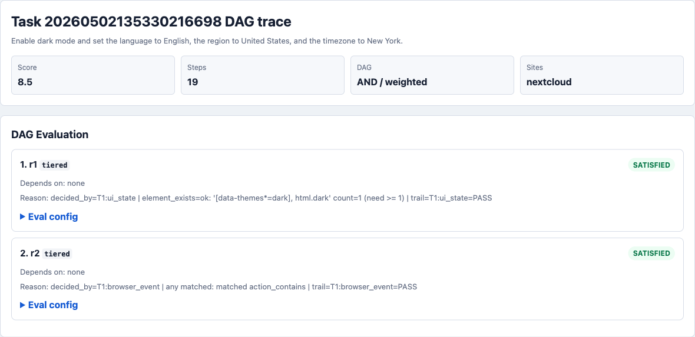

# DAG evaluator

WebArena-Pro uses the DAG evaluator for tasks with explicit, deterministic
checks. This page describes how a DAG evaluation is represented, how it runs,
and how node decisions become a task score.

A DAG evaluation is a small graph of rubric nodes. Each node represents one
criterion for the task, and dependencies express real prerequisites between
criteria. For example, a "file content is correct" node can depend on a "file
exists" node so content checks are skipped if the file was never created.

At runtime, `DAGEvaluator`:

1. parses the task's `eval` dictionary into an `EvalDAG`;
2. topologically sorts the nodes;
3. skips nodes whose dependencies failed;
4. runs each node evaluator against an `EvalContext`;
5. combines node results using the DAG's `operator` and `scoring`.

`EvalContext.task_start_time_ms` is the Unix timestamp in milliseconds captured
once at BrowserGym setup, before resets, login, and agent actions.
Every validation in that execution receives the same value. Evaluators can use
it to distinguish new records from seeded history without moving the cutoff
forward as a task runs. The separate `task_start_date` still supplies the stable
local calendar date for relative-date criteria.

A new setup/reset captures a new timestamp. BrowserGym checkpoint recovery first
resets the site and then replays saved browser actions, so replayed records are
created after that new setup timestamp. It does not reuse the old mutated site
state. Standalone grading, legacy contexts, and CLI dry runs without a recorded
execution start leave `task_start_time_ms` as `None`; evaluators must use their
explicit fallback policy rather than treating grading time as execution time.

Most current tiered task files use one `tiered` node per rubric. The `tiered`
node tries strategies in their JSON list order; it does not sort by `tier`.
Authors should place cheaper, authoritative checks before heuristic checks and
the terminal judge. The `tier` value labels the evidence in the trace.

```json
{
  "operator": "AND",
  "scoring": "partial",
  "nodes": [
    {
      "id": "r1",
      "type": "tiered",
      "depends_on": [],
      "eval_config": {
        "rubric": "The interface is set to dark mode.",
        "strategies": [
          {
            "tier": 1,
            "type": "ui_state",
            "config": {
              "checks": [
                {
                  "method": "element_exists",
                  "selector": "[data-themes*=dark], html.dark",
                  "min_count": 1
                }
              ]
            }
          },
          {
            "tier": 2,
            "type": "llm_judge",
            "config": {
              "rubric": "The interface is set to dark mode."
            }
          }
        ]
      }
    }
  ]
}
```

## Verdicts, tiers, and trust

Every strategy returns one of three verdicts:

- `PASS`: the strategy confirmed the rubric.
- `FAIL`: the strategy confirmed the rubric was not met.
- `INCONCLUSIVE`: the strategy could not tell, usually because the page,
  trajectory, endpoint, auth token, or snapshot evidence was unavailable.

The strategy's trust policy determines whether a returned verdict ends the
node or allows the next strategy to run. Defaults are selected by strategy
`type`, not by its numeric `tier`:

| Tier | Evidence source | Typical evaluator types | Default trust |
|---|---|---|---|
| 0 | Application backend, captured download, or final answer | `backend_state`, `file_downloaded`, `answer_match` | `both` |
| 1 | Recorded trajectory or captured DOM facts | `browser_event`, `ui_state` | `pass_only` |
| 2 | LLM judgment over the task context | `llm_judge` | `terminal` |

Trust controls escalation:

| Trust | PASS | FAIL | INCONCLUSIVE | Evidence model |
|---|---|---|---|---|
| `both` | final | final | falls through | Exact facts, such as status codes, structured fields, and file existence. |
| `pass_only` | final | falls through | falls through | Heuristics where a miss may be caused by phrasing or UI brittleness. |
| `terminal` | final | final | stops with no credit | Last-resort judgments; place these last. |

Unknown strategy types and strategy exceptions are recorded in the trail and
allow the next strategy to run. If the list is exhausted without an
authoritative result, the resolver uses the last concrete verdict. If none
exists, the node fails conservatively; unavailable evidence never earns credit.

The important rule is that confident deterministic failures should not be
overwritten by the LLM. If a backend check proves a file or record does not
exist, that `FAIL` is final. If a text or selector heuristic simply misses
evidence, use `pass_only` so the next strategy can look again.

Effective trust and whether it was explicit or defaulted are recorded for each
strategy in the DAG trail. The [October trust audit](evaluator-trust-audit.md)
records the 76 reported omitted-trust nodes and their individual dispositions.
Author task heuristics with explicit `pass_only`; merely adding a later judge
does not weaken an authoritative check.

## Built-in DAG strategy types

### Backend evaluation authentication

The `eval_token` API templates use `X-Eval-Token` to access read-only backend
state. The runtime provisions a token automatically for all registered sites
that use these templates: X-Lite, YT-Lite, Minerva-Lite, JobPortal, Acidwave,
MyDrive, TravelMap, Firefly, Thunderbird, Notion, and Pipedrive. App endpoints
continue to reject missing or incorrect tokens.

Token selection, shared by container startup/reset and the evaluator:

1. `WP_EVAL_TOKEN`, when set, takes precedence. It must contain nonempty printable
   ASCII without whitespace; an explicit empty value is a configuration error.
2. Otherwise, `WP_EVAL_TOKEN_FILE` selects a persistent token file. If omitted,
   the path is `$XDG_CONFIG_HOME/webarena-pro/eval-token`, defaulting to
   `~/.config/webarena-pro/eval-token`.
3. If the file is absent, the runtime atomically creates it with a random token
   and permissions `0600`. Concurrent workers use the same completed file.
   Existing files are never overwritten or silently regenerated. Files may
   end with a newline.

The automatic token is stable across `env start`, `run`, spawned workers,
prewarmed slots, and resets for the same user and configuration directory.
No setup variable is required for a standard local run. Separate hosts/users
must share the token explicitly. For example, export `WP_EVAL_TOKEN_FILE` to
the same protected shared file in **every** shell that starts containers or
runs evaluation. Alternatively, export the same `WP_EVAL_TOKEN` in those
processes. A `.env` file is not loaded consistently by every CLI entry point;
export overrides in the process environment instead.

After changing token configuration, run `webarena-pro env start <site>` with
the new configuration before reusing the site. The container manager recreates
containers whose environment differs, which resets their task state; perform
this between runs. With `--no-autostart` or manually managed Docker containers,
ensure their `WP_EVAL_TOKEN` matches the evaluator's token yourself. Do not
delete the shared file while containers/runs still use it.

Invalid configuration produces `eval_token_configuration_error`. A 401/403
from an eval-token endpoint produces `eval_token_authentication_failed` with
the site and HTTP status. These probes are `INCONCLUSIVE`, so they can fall
through to later strategies even under `trust: both`. The warning log and
tiered DAG trail retain the cause; an authenticated check whose task condition
is unmet remains `FAIL`. Token values are not included in these diagnostics
or request-header debug logs.

### Strategy implementations

`nextcloud_saved_state` supplies Tier 0 checks for tasks 159, 165, and 176,
with explicit `trust: both`. It resolves the requested names to unique account
IDs before checking Talk group membership. A `talk_rooms` baseline excludes
pre-existing rooms, and the current user's native `conversation_created` event
must establish creation during this task; joining an old room is insufficient.
Native poll objects establish the options and the current user's votes. The
reaction criterion requires all three votes on that same poll and a saved
checkmark after the latest `poll_voted` event. Equal-second timestamps require
native message IDs to establish order. Conversation titles are unrestricted.
Chat history and the account directory are paginated, and history reads leave
read markers, notifications, and online status unchanged. The API contracts are
documented in the [Nextcloud Talk API](https://nextcloud-talk.readthedocs.io/en/latest/).

For task 176, the `webdav_files` baseline opts into `include_dirs` and
`include_ids`. Stable Nextcloud file IDs distinguish newly created folders and
copies from renamed or moved objects. The evaluator accepts any destination
name, compares SHA-256 hashes of the copied files with the Safari originals,
and requires the originals to remain at their original paths and versions.
The source filenames come from `websites/nextcloud/seed/assets.json`; any of
the three seeded Safari music tracks is accepted because the task does not
specify one. A folder share must identify that same destination by path and
file ID, grant read access, and appear in the correct group's saved messages.
Native Talk shares and unprotected, non-expiring public links are supported.

The reaction nodes also have a pass-only Tier 1 `nextcloud_reaction_ui` fallback.
It requires the visible self-reaction button on the verified poll message in the
correct conversation on the active worker's site, plus native group, poll, vote,
and reaction-event evidence establishing the required ordering. An action string
alone cannot pass. Chromium regression fixtures exercise the Talk selectors.

Definitive saved-state failures stop at Tier 0. Missing snapshots, ambiguous
names, unfamiliar time wording, non-user identities that cannot be resolved,
unavailable APIs, changed file versions, and incomplete pagination escalate.
Missing creation/vote history (including private-poll votes) or ambiguous event
ordering also escalates instead of awarding deterministic credit. The LLM
rubrics require the same group creation, poll identity, ordering, and explicit
Safari source filenames as the deterministic checks. File verification is bounded
to 200 destination files and 64 MiB per file; account/history pagination is bounded
to 100 pages. Hitting
these limits is inconclusive. Snapshot and HTTP requests use the active worker's
deployment URL. Task prompts and DAG edges are unchanged; criteria receive equal
partial credit, following the current scoring model on `main`.

`backend_state` sends a real HTTP request to a site backend and checks the
response. Requests can use named recipes from `api_registry.py`, inline URLs,
HTTP basic auth, login bearer tokens, or eval-token endpoints. Its assertions
include status codes, response text, regexes, occurrence counts, JSON paths,
and snapshot diffs.

`json_collection_contains` checks that one record in a JSON object or array meets
all configured conditions. `path` selects the collection; `match` compares record
fields with literal values or `{"resolved": "binding_name"}` values from the
existing `resolve` requests. `created_since_task_start` names a timestamp field
that must be at least `EvalContext.task_start_time_ms`. Missing execution time or
malformed records make the probe inconclusive. For example:

```json
{
  "type": "json_collection_contains",
  "path": "posts",
  "match": {
    "user_id": {"resolved": "author_id"},
    "channel_id": {"resolved": "channel_id"},
    "delete_at": 0,
    "type": ""
  },
  "created_since_task_start": "create_at",
  "text": {
    "field": "message",
    "link_targets_any": ["__YT-LITE__/watch/fv238", "__YT-LITE__/watch/fv337"],
    "ignore_query_fragment": true
  }
}
```

The optional `text` assertion applies to one field of that same record.
`contains_all` requires every phrase, normalizing case, Unicode, and punctuation.
`link_targets_any` checks actual Markdown destinations or bare URLs; code, images,
and link labels do not count. URL scheme, host/port, and path must match, without
credentials. Query and fragment also match unless `ignore_query_fragment` is
true. Deployment placeholders are resolved anew at each evaluation.

An optional `pagination` block on `backend_state` collects the requested JSON
collection before assertions, for example `{"path": "posts", "count_path": "order",
"page_size": 200, "max_pages": 100}`. Requests start at page zero with `page` and
`per_page` query parameters; `page_param` and `page_size_param` can rename them.
A short page ends collection. If `count_path` is omitted, collection length is
used. HTTP errors, malformed pages, or exhausting the page limit are inconclusive,
even if an earlier page matched. Pagination is opt-in and restricted to GET.
Resolve steps can also supply `checks`; a failed prerequisite on a successful
lookup is definitive, while unavailable lookup evidence remains inconclusive.
Task 112 uses these shared features with `trust: both` to detect edits and deletions
without a separate evaluator or an LLM fallback.

`json_predicate` supports relationships between collections in the same response.
Its optional `guards` run first: a false guard or an invalid/missing reference is
inconclusive. Ordered `bindings` then derive named values, and the final `predicate`
returns a definitive pass or failure. Guards declare evidence requirements such
as schema versions, execution timestamps, and complete history; task completion
conditions belong in the final predicate or the queries it uses.

Values are JSON literals or explicit expressions. `{"ref": "data.records"}` reads
the response; `context.task_start_time_ms` reads the execution cutoff; `resolved`
contains API resolve bindings. Named bindings and query aliases are also reference
roots. A reference may specify `default` for a missing property; traversing a
non-object remains an error. `{"literal": {...}}` quotes an object, and
`{"upper": <value>}` uppercases text without changing stored evidence.

| Predicate | Meaning |
|---|---|
| `all`, `any` | Nonempty lists of predicates, evaluated with short circuiting |
| `not` | Negates one predicate |
| `eq`, `in` | Type-strict equality or membership; booleans do not equal numbers |
| `gte`, `lte`, `gt`, `lt` | Two finite numeric operands, without string coercion |
| `type` | Tests `null`, `boolean`, `integer`, `number`, `string`, `array`, or `object` |
| `some`, `every` | Quantifies a collection using `from`, `as`, and optional `where` |

Queries use `{"query": {"from": <value>, "as": "row", ...}}`. `where` filters rows;
`take: "last"` then selects the last matching row in **response order**; `select`
projects a value; `flatten: true` concatenates projected arrays. Queries and
quantifiers can reference outer aliases to correlate records. They inspect all
candidate rows so one match cannot hide a malformed later row. Aliases cannot
shadow an existing scope, and bindings cannot reference later bindings. Empty
arrays are valid evidence: `some` is false and `every` is true.

For example, this shared check selects the latest submitted request and requires
a delivery for that exact request:

```json
{
  "type": "json_predicate",
  "guards": [{
    "label": "supported schema",
    "predicate": {"eq": [{"ref": "data.version"}, 1]}
  }],
  "bindings": [{
    "name": "latest_requests",
    "value": {"query": {
      "from": {"ref": "data.requests"}, "as": "request",
      "where": {"eq": [{"ref": "request.status"}, "submitted"]},
      "take": "last"
    }}
  }],
  "predicate": {"some": {
    "from": {"ref": "data.deliveries"}, "as": "delivery",
    "where": {"some": {
      "from": {"ref": "latest_requests"}, "as": "request",
      "where": {"eq": [{"ref": "delivery.request_id"}, {"ref": "request.id"}]}
    }}
  }}
}
```

Task 344 uses this check with `site: "flight-search"` and `api: "eval_state"`.
All schema guards, duration limits, airport codes, eligible origins, event/booking
joins, and latest-route rules are in the task JSON. No Flight Search grading
helper or new DAG evaluator is required. Evidence is re-read at each checkpoint;
the outer tiered node retains the original LLM rubric only for inconclusive probes.

The `mydrive_files` snapshot provider reads MyDrive's token-protected evaluator
endpoint and keys files by database ID. For a cross-site task, set the baseline's
`params.site` to `mydrive`; the provider uses that worker's deployed URL. Baselines
include all owners and trashed files, so renames, moves, restores and ownership
changes do not appear as new files. A `snapshot_diff_added` predicate can require
`owner: agent1@test.com`, `inTrash: false` and `document: true` without checking a
filename. Document classification uses MIME metadata for native documents, text,
JSON, Word, OpenDocument, PDF and RTF files; content correctness remains separate.

This requires a rebuilt MyDrive image whose `/api/eval/state` response declares
`fileSnapshotVersion: 1` and includes file `id` and `ownerEmail`. Old images,
malformed responses and unavailable baseline/current snapshots are inconclusive
and allow the configured judge fallback. With valid snapshots, an unmet creation
check is a definitive Tier 0 failure.

HTTP content assertions require a successful 2xx response. Unexpected redirects,
authentication failures, and server errors are `INCONCLUSIVE`; their bodies cannot
prove an empty dataset or a missing record. A matching explicit `status_code`
assertion permits intentional non-2xx checks, such as checking a deleted resource
returns 404. A 404/410 that fails an explicit status assertion is a definitive
`FAIL` (for example, `file_exists` expects 200), with content checks skipped;
without that status assertion the response remains inconclusive. Resolve lookups
and login requests always require 2xx. Cached login
sessions rejected with 401 are refreshed and retried once, including after a
container reset; a persistent rejection remains inconclusive. A resolve step
that only establishes session state (such as Immich's 204 unlock response)
omits both `extract` and `bind`; extraction steps must specify both.

JSON paths use dotted object keys and nonnegative list indexes. Missing keys or
out-of-range indexes are ordinary failed conditions (`not_exists` passes), with
the missing path and list length included in the result. Invalid index syntax
or malformed paths are configuration errors and remain `INCONCLUSIVE` instead
of being reported as missing task data.

`answer_match` reads the agent's final `send_msg_to_user(...)` text and checks
`exact_match`, `must_include`, or `must_include_any` references.

`file_downloaded` checks browser downloads captured during the run, including
filename, extension, size, magic bytes, and checksum constraints.

`browser_event` scans recorded action strings and visited URLs for configured
patterns. It is useful for "the agent visited/opened/clicked X" style rubrics.

`ui_state` grades UI evidence captured by the adapter at evaluation time. It supports
selector existence and text checks, but selectors are intentionally treated as
heuristic unless the strategy is configured with stronger trust.

For saved-state criteria, scope UI checks to the exact object and its current
state. Task 171's Tier 1 favorite check requires the current `/marketing`
breadcrumb and a visible favorite marker on the `strategy.md` row, excluding
loading or failed rows. A recorded favorite action alone is insufficient.
Unavailable or unmatched UI evidence falls through to the judge under
`pass_only`; a definitive backend failure still stops at Tier 0.

`mattermost_calls` checks native one-to-one call records and saved callback
messages for a configured `caller` and list of `recipients`. Its `criterion`
is `started`, `unanswered_ended`, or `callback`. The first two require native
`custom_calls` posts; a click or a message mentioning a call is insufficient.
Records are filtered by `task_start_time_ms`. Legacy contexts without that
timestamp use `task_start_date` at UTC midnight; without either, evidence is
inconclusive. `unanswered_ended` also checks the call duration
(`minimum_seconds`, default 30) and participants. Missing participant metadata
in an otherwise qualifying ended call is inconclusive. `callback` first checks
saved message authorship and recipients, then invokes the LLM judge to assess
the actual message wording. Task 109 explicitly uses `both` for its call checks
and `terminal` for callback semantics. Configure trust explicitly for this type;
it otherwise receives the resolver's `pass_only` default for unlisted types.

`llm_judge` asks a judge model to decide the rubric from the available task
context. In tiered nodes, it is the terminal fallback strategy.

The default model is [Qwen3.6 27B on OpenRouter](https://openrouter.ai/qwen/qwen3.6-27b),
using the model ID `qwen/qwen3.6-27b`. Set `OPENROUTER_API_KEY` to use it;
`OPENROUTER_BASE_URL` optionally overrides `https://openrouter.ai/api/v1`.
Set `WEBARENAPRO_LLM_JUDGE_MODEL` to choose another model globally, or set
`model` in a judge node's `eval_config` (or a tiered strategy's `config`) to
override it for that judge. Explicit vLLM model IDs such as `Qwen/Qwen3.6-27B`
continue to use `VLLM_API_KEY` and `VLLM_BASE_URL`.

Execution-scoped [identical-input reuse](evaluator-stability.md) avoids resampling
an unchanged captured request and records the original verdict provenance.
Changed evidence and reset scopes still require fresh judgments.
Tasks 112 and 344 use [deterministic current-state checks](evaluator-stability.md#deterministic-tasks-112-and-344)
for exact recipe-video links and flight booking reversals. Task 112 has no LLM
fallback; task 344 retains Tier 2 only for inconclusive deterministic probes.
Definitive backend failures cannot be overridden by an LLM verdict.

The [image contract guide](evaluator-images.md) describes how to verify that
released images expose the authenticated evaluation routes used by task files.

### Configuring snapshot evidence

Snapshot checks need a baseline captured before the agent changes application
state. Add `baseline` alongside `nodes` in the task's `eval` object, with a unique
`name`, registered `provider`, and provider-specific `params`. For example, this
fragment captures MyDrive files for a cross-site task whose primary site may be
Acidwave:

```json
{
  "baseline": [
    {
      "name": "mydrive_files",
      "provider": "mydrive_files",
      "params": {"site": "mydrive"}
    }
  ]
}
```

Reference that name from a `backend_state` node's `eval_config`, or a tiered
strategy's `config`. This example requires at least one newly created document
owned by the specified user:

```json
{
  "baseline_ref": "mydrive_files",
  "checks": [
    {
      "type": "snapshot_diff_added",
      "predicate": {
        "attr_equals": {
          "owner": "agent1@test.com",
          "inTrash": false,
          "document": true
        }
      },
      "min_count": 1
    }
  ]
}
```

BrowserGym setup fetches baselines after reset/login and before
agent actions, then fetches current snapshots at grading. Providers receive the
task's primary site and their parameters; `mydrive_files` specifically supports
`params.site` to select another site. `immich_assets` supports `exclude_year`,
used by task 092 to track original photos outside 2015. See the
[snapshot provider API](api/evaluation.rst) for the registered
provider classes.

A failed snapshot fetch is recorded as unavailable, not as an empty collection.
Missing baseline/current evidence or an unavailable diff makes the snapshot
check inconclusive. The configured tiered policy then determines fallback or
failure; task 092's preservation check deliberately has no judge fallback.
Standalone Core callers must capture and supply the equivalent
`EvalContext.baselines` bundle themselves. See the
[task configuration guide](https://github.com/McGill-NLP/webarena-pro/blob/main/webarena-pro-core/src/webarena_pro_core/config/README.md)
for placement in a task record.

## Dependencies and scoring

When a node lists `depends_on`, all dependency nodes must pass before the node
runs. A dependency failure marks the dependent node as skipped/failed without
running its checks.

Scores are computed from node results:

- `binary` with `AND` returns `1.0` only when every node passes.
- `binary` with `OR` returns `1.0` when any node passes.
- `partial` returns the fraction of nodes that passed. Every criterion counts
  equally; skipped nodes remain in the denominator as failed criteria.

All packaged Dev and Test tasks use `partial` scoring. Only `binary` and
`partial` scoring modes are supported.

## DAG trace screenshot

The run dashboard and XRay render a per-task DAG trace so reviewers can inspect
which tier decided each rubric and why. This screenshot is from a real
`webarena-gcp` run:
`tiered_gemini_3_5_flash_deploy65a48255_all_43_combined_20260712_201657`,
task `20260502135330216698`.



In this trace, the dark-mode rubric was satisfied by a Tier-1 `ui_state`
selector, while the timezone rubric was satisfied by a Tier-1 `browser_event`
match. Neither node needed to fall through to the LLM fallback.

## Auditing and replaying LLM judgments

The default Tier-2 judge retains a versioned audit for every invocation in
`dag_results[node_id].judge_audits`, including when called through a tiered
strategy. BrowserGym saves these records in each compressed step artifact and
in an experiment-level `judge_audits.json` sidecar (mode `0600`). Standalone Core callers
receive the records in their normal evaluation result and should persist that
result using their runner's artifact storage. Direct judge callers can inspect
`EvalContext.judge_audits`. Custom `set_llm_judge_hook` implementations still own
their own evidence and do not fabricate default-model audit records.

Each audit identifies the task, original task ID, rubric, execution date, prompt
version, requested model, endpoint, SDK version/retry setting, judge retry budget,
and effective completion arguments. Each logical SDK call records its exact messages
(including inline screenshot bytes), a SHA-256 of the request, elapsed time,
the complete JSON model response (including explanation, returned model, finish
reason and token usage when supplied), parsed answer and verdict. If the regular
prompt fails and a retry is used, every request (including error feedback) and
its outcome is retained. SDK-internal HTTP retries are not separate audit entries.
Provider defaults for omitted parameters remain provider-controlled; a captured
request does not freeze the provider's model implementation.

Audit statuses distinguish `positive`, `negative`, `parse_error`, `model_error`
and `configuration_error`. Errors continue to receive a conservative failed
score; a missing/invalid answer is no longer reported as an ordinary negative
judgment. Exception text and credential headers are not stored. An endpoint's
userinfo, query and fragment are stripped; endpoints relying on those fields
need standard API-key authentication to be replayed. The full returned model
content and supplied evidence can contain sensitive task data. Keep audits under
the same access controls as trajectories, and review them before sharing. Inline
images make each record self-contained and increase disk use; repeated rubrics
and a pruned retry can duplicate the same screenshot. The compact DAG trace
contains the status/reason, while complete evidence stays in `dag_results` and
the sidecar.

The judge makes one initial call and retries up to **three times** after parsing
or model-call errors (at most four logical SDK calls). Each retry includes the
previous error message and the failed assistant response when available. Parsing
errors retain the original evidence; after a model-call error, retries omit the
accessibility tree, preserving the screenshot and other evidence. Both error
types consume the same retry budget. API-error feedback uses the exception type
and HTTP status when available; raw exception strings are never sent back or
stored because they can contain credentials or request bodies.

A valid judgment stops immediately, including `Unsuccessful` or `In Progress`.
An exhausted budget retains the last error status and receives a failed score.
Configuration errors are not retried. Configure the number of **additional**
calls globally:

```bash
export WEBARENAPRO_LLM_JUDGE_MAX_RETRIES=3
```

Or override it in an individual judge node's `eval_config` (or a tiered judge
strategy's `config`):

```json
{
  "id": "record_saved",
  "type": "llm_judge",
  "eval_config": {
    "rubric": "The record was saved with the requested changes.",
    "max_retries": 1
  }
}
```

The value must be a non-negative integer; `0` disables all judge retries,
including the pruned fallback. A per-node value overrides the environment.
Invalid settings produce a `configuration_error` before any model call. This
budget is separate from the OpenAI SDK's internal HTTP retries, which remain
unchanged and are recorded as `sdk_max_retries` in the audit.

For a provider behind a proxy that times out long non-streaming generations,
set `WEBARENAPRO_LLM_JUDGE_STREAM=1` (default `0`). The SDK assembles streamed
text, reasoning, finish reasons, and usage before Core applies the same verdict
parser. An interrupted stream cannot publish a partial verdict. Model settings,
prompts, scoring, and retry budgets are unchanged. The transport is recorded in
the audit and retained by replay. In Harbor, use `WP_HARBOR_JUDGE_STREAM=1` to
pass this setting privately to the browser/evaluator service.

The default Qwen judge uses temperature 0.6, top-p 0.95 and maximum 4096 output
tokens. Other provider-specific sampling defaults remain unchanged (for example,
Gemini temperature 1.0 and top-p 0.95). To run a sampling experiment:

```bash
export WEBARENAPRO_LLM_JUDGE_SAMPLING='{"temperature":0,"max_tokens":4096}'
```

A judge node/strategy may instead supply `"sampling": {"temperature": 0}` in its
config; per-node fields override environment fields. Allowed fields are
`temperature` (0–2), `top_p` (0–1, excluding 0), positive integer `max_tokens`,
and integer `seed`. Providers may support only a subset; unsupported requests
produce an audited model error. Temperature zero or a seed does not guarantee
identical answers. No voting or scoring aggregation is introduced.

Replay a captured node without reconstructing its evidence from a later task
version. The command uses the model's normal credential environment variables,
the saved endpoint and completion arguments, and the final actual request
(including error feedback and pruning if they occurred):

```bash
python -m webarena_pro_core.eval.judge_audit \
  /path/to/experiment/judge_audits.json \
  --audit-id AUDIT_ID --repeats 3 --output replay.json
```

This makes model calls. The output must be a new file. `--attempt 0` explicitly
selects an earlier request, including one that originally failed; the source
attempt/status is recorded. Ambient `WEBARENAPRO_LLM_JUDGE_SAMPLING` and
`WEBARENAPRO_LLM_JUDGE_MAX_RETRIES` and `WEBARENAPRO_LLM_JUDGE_STREAM` do not
change a replay; each repeat submits
the frozen request once, without a new judge retry loop.
Use `--sampling '{"temperature":0}'` to make an explicit
comparison, which is recorded as an override. Supply multiple input files to
measure a representative set. Each case reports every repeated response, status
counts, pass/fail counts, token usage, elapsed time, unanimity and pairwise
agreement among valid verdicts (`matching pairs / all valid pairs`). Errors are
counted separately and excluded from agreement; fewer than two valid verdicts
produce `null`, not perfect agreement. These repeats never alter task scores.
Token usage measures work performed, not monetary cost; model pricing is not
assumed.

For the reported task 382 disagreement, the stable original task ID is
`20260504022131958379` (the Alive Galaxy video background-style question). Select
the audit for its watch-video rubric and replay it with the command above.
Older runs that discarded the original prompt or response cannot recover that
missing evidence. Reconstructing a prompt from an archived trajectory and
current templates is a new judgment, not a reproduction of the original one.

### CalDAV event predicates

A `backend_state` check of type `caldav_event` applies the existing predicate
vocabulary to each decoded, active VEVENT in a CalDAV REPORT. Fields are
`summary`, `description`, `text` (summary plus description), and `date` (the
event's local ISO calendar date). All predicate conditions must match one event;
cancelled events do not match. XML entities, iCalendar line folding, and TEXT
escapes are decoded before comparison. Malformed DAV/iCalendar is an
inconclusive probe, preserving the tiered evaluator's existing error handling.

### Immich deletion and preservation

Task 092 accepts selecting 2015 photos from the timeline or any other valid UI
route; a date-filter search is not required. Its four nodes and dependency are
preserved, and each criterion counts equally. Authenticated, date-filtered API
checks verify that the active library and Trash contain no 2015 photos.
Definitive failures remain authoritative.

The `immich_assets` snapshot provider records active photo IDs before the task
and again at grading. With `exclude_year: 2015`, task 092 checks that none of the
original other-year IDs were removed; an unrelated replacement cannot hide a
deletion by restoring the total count. BrowserGym uses its existing snapshot
hooks. Replay evaluation must retain the task's baseline evidence. This
preservation criterion has no LLM fallback: missing snapshots, failed or
incomplete fetches, and unavailable diffs cannot establish that every original
photo remains. They receive no preservation credit. The shared snapshot
evaluator still reports unavailable evidence as inconclusive for other tasks'
configured fallback policies.


## Browser evidence boundary

Core evaluation receives `EvalContext.ui_evidence`, a versioned record of browser
facts. Evaluators never receive a live page or locator. Core's bundled
`webarena_pro_core.ui_evidence` module collects these facts through equivalent
sync and async APIs. Playwright and evaluator libraries are installed with Core;
install the Chromium binary for live browser capture.
Collection is private evaluation work, outside the agent tool and step budgets;
selectors and captured evaluator evidence must not be added to model prompts.

```python
from webarena_pro_core.eval.dag import DAGEvaluator, EvalContext, parse_eval_dag
from webarena_pro_core.eval.ui_evidence import build_ui_evidence_plan
from webarena_pro_core.ui_evidence.async_api import collect_ui_evidence

plan = build_ui_evidence_plan(eval_config)
evidence = await collect_ui_evidence(page, plan, step=5)
context = EvalContext(
    ui_evidence=evidence,
    evaluation_id=evidence.evaluation_id,
    evaluation_step=evidence.step,
    evaluation_tab_id=evidence.tab_id,
    # Also supply normal trajectory, baseline, download, and judge evidence.
)
score, details = DAGEvaluator(parse_eval_dag(eval_config)).evaluate(context)
```

`build_ui_evidence_plan` includes nested tiered strategies and deduplicates
identical probes. Core applies task predicates to captured counts and first-match
inner text; the collector retains Playwright selector semantics such as
`:visible`. Nextcloud reaction collection records visible emoji text, selected
state, and message IDs from the current conversation. Core still requires the
correct site/conversation plus native account, poll, vote, and reaction timing
evidence. Rendered reactions are not a substitute for those backend checks.

The schema records version, evaluation ID, step (when known), tab index, page
URL, document identity, capture time/status, plan digest, and per-probe results.
A navigation, document reload, or tab-index change during capture invalidates
the snapshot. Callers must keep the selected page stable and collect at the
requested evaluation cutoff. Core verifies supplied evaluation/step/tab bindings
and compares the capture URL with the current observation when available.

A successful capture with zero matches is a concrete negative under the existing
tiered trust rules. Missing, failed, stale, unsupported, or truncated evidence is
inconclusive. Limits are 128 probes, 16,384 characters per text, 512 reaction
records, and 4 MiB per capture. UI facts are saved in the adapters' private
`ui_evidence` evaluation result field; they are not injected into observations.
Judge-cache invalidation includes semantic UI facts but excludes capture time,
evaluation IDs, step numbers, and document identity when the facts are unchanged.

### Migration and saved evaluations

`EvalContext(page=...)` is removed. Adapters collect first, then supply
`ui_evidence` and its bindings. BrowserGym uses the sync collector; async
adapters use the async collector. Browser fixtures test the collector module;
evaluator tests grade plain data fixtures. Both suites live in Core, with browser
fixtures under `tests/ui_evidence/`.

Save `evidence.model_dump(mode="json")` with the exact evaluation cutoff. To
re-evaluate its UI checks, select that trusted record and call
`restore_ui_evidence(context, saved_record)`. Other context fields (backend
snapshots, task start time, trajectory, and judge inputs) must still be provided;
UI evidence alone does not make live backend checks replayable. Older traces
without captured UI evidence keep UI checks inconclusive. Never infer missing
DOM facts from screenshots or accessibility text, or use agent-supplied records.
The backend-only dry-run entry point intentionally supplies no UI evidence.

Core evaluation remains synchronous. Async callers should offload blocking
backend and judge requests; no additional Playwright connection is needed for
that work. Native async backend/judge networking is a separate concern.
